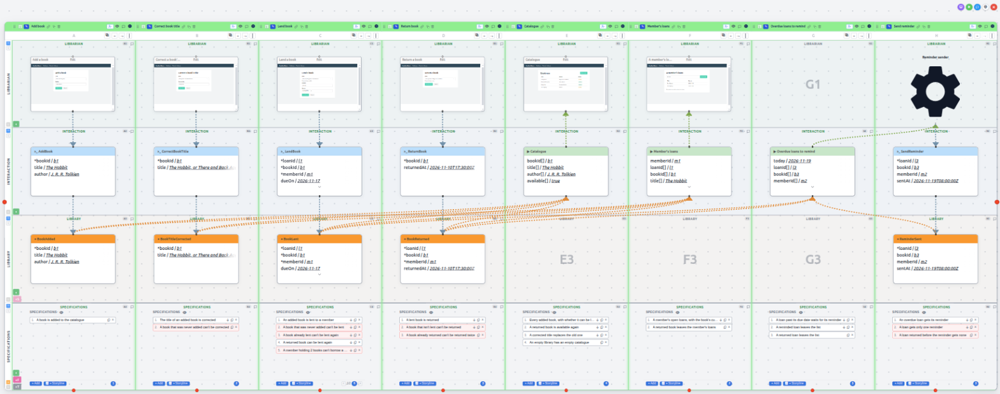

# Lending library

The worked example of the
[eventmodelers Elixir/FACT build kit](https://github.com/ortegacmanuel/eventmodelers-elixir-fact-kit):
a small lending library, modelled on an [eventmodelers.ai](https://eventmodelers.ai)
board and built slice by slice by the kit's agent loop. Event sourcing on
[`fact`](https://hex.pm/packages/fact): files on disk, no database.

**What was generated and what wasn't.** The eight slices under
`lib/library/slices/` were built by the loop, one `feat:` commit each, from the
board's definitions. The six LiveViews under `lib/library_web/live/` were
written afterwards, by hand, from the screen briefs the loop left in
`docs/screens/`. `git log` shows it in that order.

## The model

[](docs/model.png)

The board isn't public, so the model travels with the code:
`.build-kit/.slices/lending-library/<slice>/slice.json` is the full definition
of each slice — fields, events, scenarios, screens — as fetched from the board.

| slice | type | reads | writes | screen |
|---|---|---|---|---|
| Add book | write | `AddBook` | `BookAdded` | Add a book |
| Correct book title | write | `CorrectBookTitle` | `BookTitleCorrected` | Correct a book's title |
| Lend book | write | `LendBook` | `BookLent` | Lend a book |
| Return book | write | `ReturnBook` | `BookReturned` | Return a book |
| Catalogue | read | `BookAdded`, `BookTitleCorrected`, `BookLent`, `BookReturned` | — | Catalogue |
| Member's loans | read | `BookAdded`, `BookTitleCorrected`, `BookLent`, `BookReturned` | — | A member's loans |
| Overdue loans to remind | read (TODO list) | `BookLent`, `BookReturned`, `ReminderSent` | — | — |
| Send reminder | automation | Overdue loans to remind | `SendReminder` → `ReminderSent` | — |

The rules are the board's scenarios, one `describe` each in
`test/library/slices/<slice>/core_test.exs`. Lend book, for instance: a book
already lent can't be lent again, and a member holding two books can't borrow a
third.

**The automation follows Event Modeling's TODO-list pattern.** A lent book
whose due date has passed is on *Overdue loans to remind*; its return, or its
reminder, takes it off. *Send reminder* polls that list every minute through
`OverdueLoansToRemind.Context.pending/0`, mails the member and records
`ReminderSent`. The mailer is a fake that only logs one line per reminder, so
the example runs without credentials — and the board says so.

## Running it

```bash
mix setup          # deps, the fact store, assets
mix phx.server     # http://localhost:4000
mix precommit      # compile with warnings as errors, format, the test suite
```

Two things from the kit's README that apply here too:

- **Keep the path short.** FACT locks through a Unix socket, capped at ~104
  characters; a deep path fails at boot with `Fact.Database … :einval`.
- **On OTP 27**, `mix tailwind.install` fails on a certificate;
  `./scripts/ensure-asset-binaries.sh` fetches the same binaries with `curl`.

## How it was built

1. The chapter "Lending library" was modelled on the board: events, commands,
   read models, the TODO list and its automation, scenarios, screens.
2. Every slice was reviewed and moved to `Planned`.
3. The kit's loop (`node .build-kit/ralph-claude.js`) took them one at a time:
   build the slice with its skill, run `mix precommit`, commit, mark it `Done`.
4. The LiveViews were written from `docs/screens/`, then everything was
   checked by hand in the browser.

Two lessons went back into the kit. The first build of *Send reminder* recorded
the reminder and sent nothing, because the board didn't name the external
system; now it does (`a93e19f`). And the loop built the automation before its
TODO list, which is why every TODO list now exposes `pending/0` and a guard
checks that the two agree.

## Where things are

| path | what |
|---|---|
| `lib/library/slices/<slice>/` | one folder per slice: `core.ex` (the pure decision or fold), `context.ex`, command and events; `processor.ex` for the automation |
| `lib/library/` | the kit's framework: `decide`, `reader`, `state_change`, `state_view`, `command`, `event` |
| `test/library/slices/<slice>/` | the board's scenarios, and nothing else |
| `test/library/` | the kit's guards: slice isolation, scenario tests only, every TODO list exposes `pending/0`, … |
| `docs/screens/` | the screen brief the loop wrote for each screen |
| `.build-kit/.slices/` | the model, as fetched from the board |
| `.build-kit/CLAUDE.md`, `.claude/skills/build-*` | the kit's blueprint and skills |
| `.build-kit/AGENTS.md`, `progress.txt` | what the loop learned and logged while building — kept on purpose |

The CLI's own files — the root `CLAUDE.md` and the skills `connect`,
`load-slice`, `request-feedback`, `update-slice-status`,
`learn-eventmodelers-api`, `ui-contract` and `comic` — aren't in this repo.
`npx @eventmodelers/cli init` installs them, under the CLI's own licence.

## License

MIT — see [LICENSE](LICENSE).
